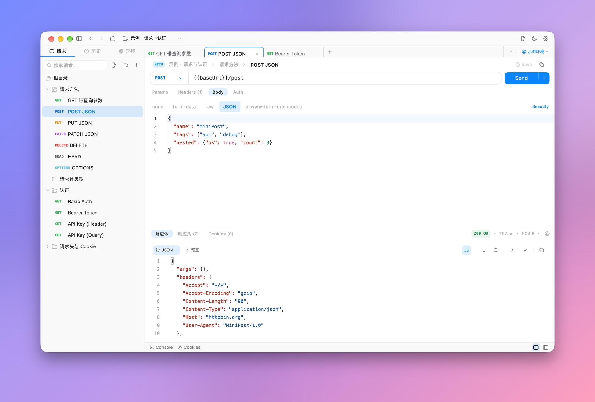
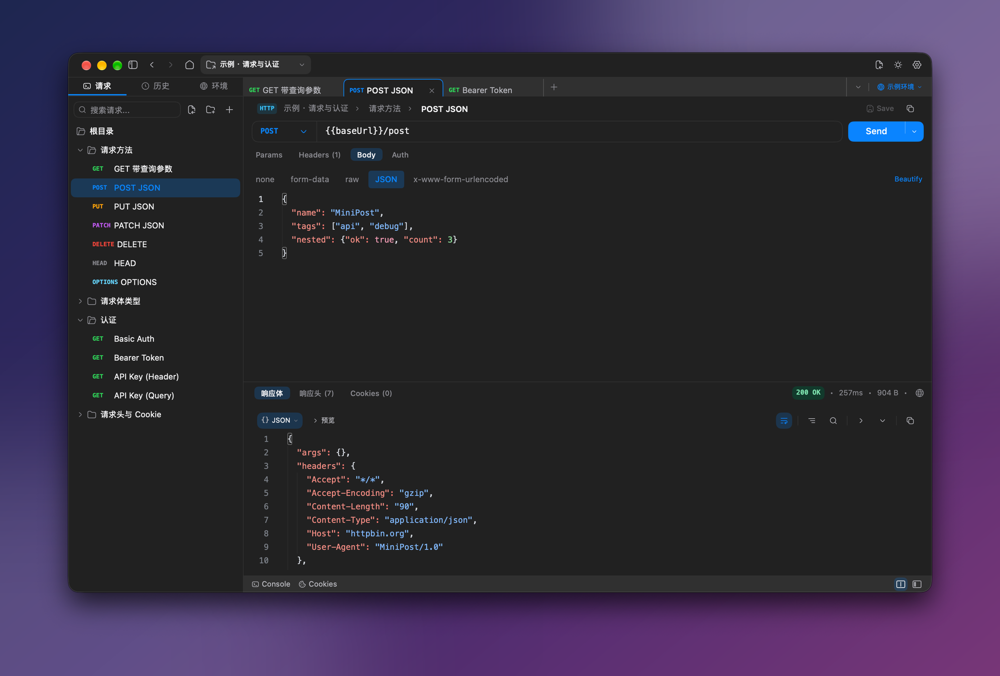
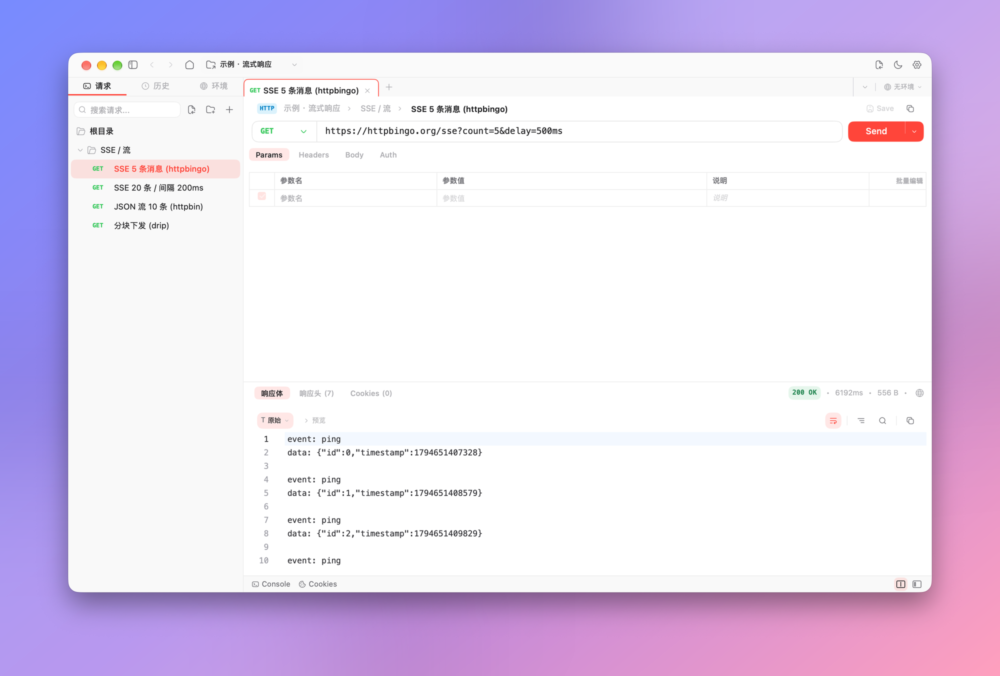

# MiniPost

<p align="left">
  <b>English</b> | <a href="README_zh.md">简体中文</a>
</p>

MiniPost is a lightweight, macOS-only API debugging tool. Since 2.0 the UI is written with [MyGo](https://github.com/egoist/mygo): pure Go, GPU-drawn native UI, no WebView and no frontend toolchain.

<p align="center">
  
</p>

<p align="center">
  
</p>

> The screenshots show the Chinese UI; the language can be switched to English in Settings.

## Features

- **Requests**: all HTTP methods, query params, headers, JSON / raw / form-urlencoded / form-data bodies, Basic / Bearer / API Key auth, `{{variable}}` substitution from environments, cookie jar, auto headers.
- **Projects and collections**: multiple projects with a per-project theme color, nested folders, move, duplicate, rename, search, history, import (Postman, OpenAPI, cURL) and export (Postman collection, cURL).
- **Chrome-like tabs**: the active tab merges with the content area, middle-click to close, `⌃Tab` to cycle, right-click for save / copy cURL / close others / close to the right.
- **Responses**: JSON / XML / JS / Hex / Base64 views, filter, JSON preview, copy and download, headers and cookies, request error diagnostics, live streaming (SSE / chunked).
- **Environments and cookies**: per-project variables, one-click switch, cookie manager.
- **Auto update**: checks hourly in the background, downloads automatically and asks to restart with one click.
- **Local and private**: data lives in `~/.minipost` (owner-only permissions); logs never contain request bodies, tokens or cookies.

<p align="center">
  
</p>

### Keyboard shortcuts

| Action | Shortcut |
| --- | --- |
| Send request | `⌘ Enter` |
| Save / close tab | `⌘ S` / `⌘ W` |
| New request / folder | `⌘ N` / `⌘ ⇧ N` |
| Import cURL / collection | `⌘ I` / `⌘ O` |
| Rename / duplicate / delete selected node | `⌘ E` / `⌘ D` / `⌫` |
| Find in response | `⌘ F` |
| Next / previous tab | `⌃ Tab` / `⌃ ⇧ Tab` (or `⌘ ⇧ ]` / `⌘ ⇧ [`) |
| Copy as cURL | `⌘ ⇧ C` |
| Environments | `⌘ ⌥ E` |
| Toggle sidebar / console | `⌘ B` / `⌘ J` |
| Settings | `⌘ ,` |

## 1. Requirements

- macOS 12 (Monterey) or later (set by `macos.minimumSystemVersion` in `mygo.json`)
- Go 1.27+
- MyGo CLI:

```bash
go install github.com/egoist/mygo/cmd/mygo@latest
```

## 2. Local Development

```bash
./scripts/dev.sh        # builds and launches "MiniPost Dev"
go test ./...           # all tests, including headless UI tests (ui.Tester)
go test -race ./...     # the same with the race detector (also run in CI)
```

Code layout (see [docs/architecture.md](docs/architecture.md) for layering rules):

- `main.go`, `app*.go`: entry point and the backend facade (`main.App`)
- `internal/gui`: native UI (sidebar, tabs, request editor, response viewer, dialogs); talks to the backend through the `Backend` interface so it can be tested with a fake
- `internal/client`: pure-Go client logic (URL/Params sync, variables, cookie jar, auto headers, cURL, settings and session persistence)
- `internal/service`, `internal/repository`, `internal/model`, `internal/pkg`: business logic, storage (`~/.minipost`) and utilities

Use **File → Add Sample Projects** to create demo projects (methods, auth, response formats, status codes, streaming) that exercise every part of the UI.

## 3. Viewing Logs

MiniPost writes logs to both the terminal and local files:

- Log directory: `~/.minipost/logs/`
- Daily log file: `~/.minipost/logs/minipost-YYYY-MM-DD.log`
- Real-time monitoring: `tail -f ~/.minipost/logs/minipost-$(date +%F).log`

The default log level is `DEBUG`. Override it with an environment variable:

```bash
MINIPOST_LOG_LEVEL=INFO ./scripts/dev.sh
```

Supported levels: `DEBUG`, `INFO`, `WARN`, `ERROR`, `FATAL`.

## 4. Build

```bash
./scripts/build.sh                            # current arch: .app + .dmg
./scripts/build.sh -skip-dmg                  # .app only
./scripts/build.sh -platform darwin/universal # arm64 + amd64 in one app
```

Artifacts are written to `build/`:

- `build/darwin-<arch>/MiniPost.app`
- `build/minipost-<version>-<arch>.dmg`

The version comes from `mygo.json`.

## 5. Signing and Notarization

By default the app is ad-hoc signed (fine for local use). For distribution, set `macos.signingIdentity` and `macos.notarize` in `mygo.json` (or pass `-sign "Developer ID Application: Your Company (TEAMID)"`) and follow the MyGo documentation for notarization credentials.

## 6. Authorizing an Unnotarized App (Internal Distribution)

Remove the quarantine flag:

```bash
xattr -dr com.apple.quarantine "build/darwin-arm64/MiniPost.app"
# or
./scripts/macos-authorize.sh "build/darwin-arm64/MiniPost.app"
```

Optional local trust (requires administrator privileges):

```bash
sudo spctl --add --label "MiniPost Local Trust" "build/darwin-arm64/MiniPost.app"
```

## 7. Auto Update and Releasing

- The app checks for updates 10 seconds after launch and then hourly, downloads new versions automatically (switchable in Settings → About) and shows a prompt; one click restarts into the new version.
- To release: bump `version` in `mygo.json`, add a `## x.y.z` section to `CHANGELOG.md` (it becomes the update notes), commit, then run `scripts/release.sh`. It runs the checks, builds a signed universal app locally, uploads a draft GitHub release and publishes it. Update signatures use the private key in `~/Library/Application Support/mygo/update-keys/mygo-update.key` (or `MYGO_UPDATER_PRIVATE_KEY`).
- Development builds carry no update key, so updates only work end to end for released builds.
