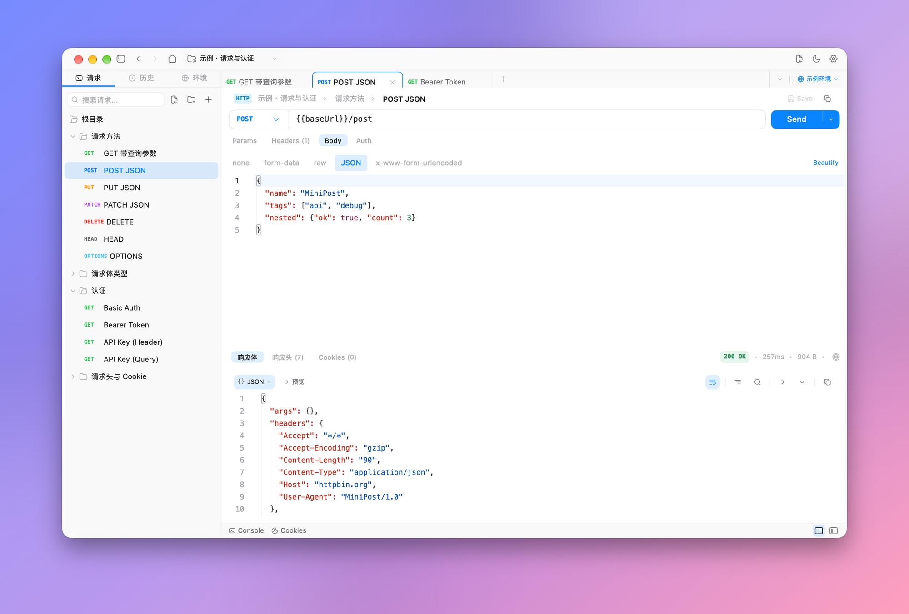
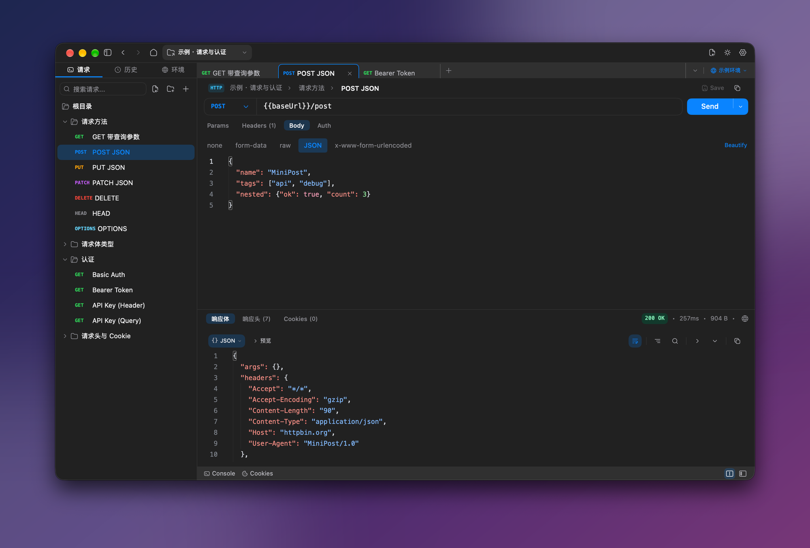
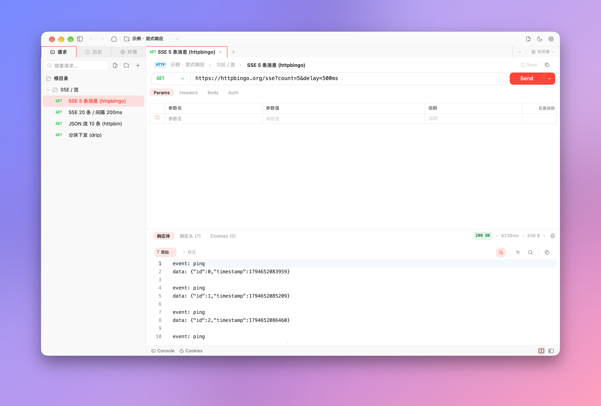

# MiniPost

<p align="left">
  <a href="README.md">English</a> | <b>简体中文</b>
</p>

MiniPost 是一个轻量的、仅支持 macOS 的 API 调试工具。2.0 起界面使用 [MyGo](https://github.com/egoist/mygo) 编写：纯 Go、GPU 绘制的原生界面，没有 WebView，也没有前端工具链。

<p align="center">
  
</p>

<p align="center">
  
</p>

## 功能

- **请求**：全部 HTTP 方法，查询参数、请求头，JSON / 文本 / 表单 / 文件表单请求体，Basic / Bearer / API Key 认证，环境变量 `{{变量}}` 替换（另有发送前现场求值的内置变量 `{{$timestamp}}` `{{$timestampMs}}` `{{$isoTimestamp}}` `{{$randomUUID}}` `{{$randomInt}}`），Cookie 罐，自动请求头。
- **项目与集合**：多项目并可单独设置主题色，多级文件夹，移动、复制、重命名、搜索，历史记录，导入（Postman、OpenAPI、cURL）与导出（Postman 集合、cURL）。
- **浏览器式标签**：选中标签与内容区融为一体，鼠标中键关闭，`⌃Tab` 切换，右键可保存、复制 cURL、关闭其他、关闭右侧。
- **响应**：JSON / XML / JS / Hex / Base64 格式切换，过滤，JSON 预览，复制与下载，响应头与 Cookie，请求错误诊断，流式响应（SSE / 分块）实时显示。
- **环境与 Cookie**：按项目管理变量、一键切换，Cookie 管理。
- **自动更新**：后台每小时检查，自动下载，下载完成后提示，点一下即可重启更新。
- **本地且私密**：数据保存在 `~/.minipost`（仅当前用户可访问）；日志不记录请求体、令牌和 Cookie。

<p align="center">
  
</p>

### 快捷键

| 操作 | 快捷键 |
| --- | --- |
| 发送请求 | `⌘ Enter` |
| 保存 / 关闭标签 | `⌘ S` / `⌘ W` |
| 新建请求 / 文件夹 | `⌘ N` / `⌘ ⇧ N` |
| 导入 cURL / 集合 | `⌘ I` / `⌘ O` |
| 重命名 / 复制 / 删除选中节点 | `⌘ E` / `⌘ D` / `⌫` |
| 在响应中查找 | `⌘ F` |
| 下一个 / 上一个标签 | `⌃ Tab` / `⌃ ⇧ Tab`（或 `⌘ ⇧ ]` / `⌘ ⇧ [`） |
| 复制为 cURL | `⌘ ⇧ C` |
| 环境管理 | `⌘ ⌥ E` |
| 显示 / 隐藏侧栏、控制台 | `⌘ B` / `⌘ J` |
| 设置 | `⌘ ,` |

## 1. 环境要求

- macOS 12（Monterey）或更高（由 `mygo.json` 的 `macos.minimumSystemVersion` 决定）
- Go 1.27+
- MyGo CLI：

```bash
go install github.com/egoist/mygo/cmd/mygo@latest
```

## 2. 本地开发

```bash
./scripts/dev.sh        # 构建并启动「MiniPost Dev」
go test ./...           # 全部测试，包含无头界面测试（ui.Tester）
scripts/check.sh        # gofmt + go vet + staticcheck + go test -race（提交前运行）
```

代码结构（分层规则见 [docs/architecture.md](docs/architecture.md)）：

- `main.go`：程序入口（`mygo build` 要求入口在仓库根目录）
- `internal/app`：后端门面（`app.App`），实现 `gui.Backend`，含备份与恢复
- `internal/gui`：原生界面（侧栏、标签、请求编辑、响应查看、对话框）；只通过 `Backend` 接口访问后端，便于用假后端测试
- `internal/client`：纯 Go 的客户端逻辑（URL/参数同步、变量、Cookie 罐、自动请求头、cURL、设置与会话持久化）
- `internal/service`、`internal/repository`、`internal/model`、`internal/pkg`：业务逻辑、存储（`~/.minipost`）与工具

用 **文件 → 添加示例项目** 可以创建演示项目（请求方法、认证、响应格式、状态码、流式响应），覆盖界面的各个部分。

## 3. 查看日志

MiniPost 同时把日志输出到终端和本地文件:

- 日志目录:`~/.minipost/logs/`
- 按天日志文件:`~/.minipost/logs/minipost-YYYY-MM-DD.log`
- 实时查看:`tail -f ~/.minipost/logs/minipost-$(date +%F).log`

默认日志级别为 `DEBUG`,可通过环境变量调整:

```bash
MINIPOST_LOG_LEVEL=INFO ./scripts/dev.sh
```

支持级别:`DEBUG`、`INFO`、`WARN`、`ERROR`、`FATAL`。

## 4. 构建

```bash
./scripts/build.sh                            # 当前架构:.app + .dmg
./scripts/build.sh -skip-dmg                  # 仅 .app
./scripts/build.sh -platform darwin/universal # arm64 + amd64 合并为一个 app
```

产物输出到 `build/`:

- `build/darwin-<arch>/MiniPost.app`
- `build/minipost-<version>-<arch>.dmg`

版本号取自 `mygo.json`。

## 5. 签名与公证

默认使用 ad-hoc 签名(本机使用足够)。正式分发时,在 `mygo.json` 中配置 `macos.signingIdentity` 与 `macos.notarize`(或通过 `-sign "Developer ID Application: Your Company (TEAMID)"` 传入),公证凭据配置参见 MyGo 文档。

## 6. 未公证应用的授权(内部分发)

移除隔离属性:

```bash
xattr -dr com.apple.quarantine "build/darwin-arm64/MiniPost.app"
# 或
./scripts/macos-authorize.sh "build/darwin-arm64/MiniPost.app"
```

可选的本机信任(需要管理员权限):

```bash
sudo spctl --add --label "MiniPost Local Trust" "build/darwin-arm64/MiniPost.app"
```

## 7. 自动更新与发版

- 应用启动 10 秒后以及之后每小时检查一次更新，发现新版本自动下载（设置 → 关于里可关闭）并弹出提示，点一下就重启进入新版本。
- 发版：修改 `mygo.json` 的 `version`，在 `CHANGELOG.md` 加一个 `## x.y.z` 小节（会作为更新说明），提交后运行 `scripts/release.sh`。脚本会跑检查、本地构建并签名通用包、上传到 GitHub 草稿 release 并发布。更新签名使用 `~/Library/Application Support/mygo/update-keys/mygo-update.key`（或环境变量 `MYGO_UPDATER_PRIVATE_KEY`）里的私钥。
- 开发构建不带更新密钥，只有发布过的版本才能完整验证更新流程。

## 8. 许可证

[MIT](LICENSE) © 2026 ixxxxoooo
